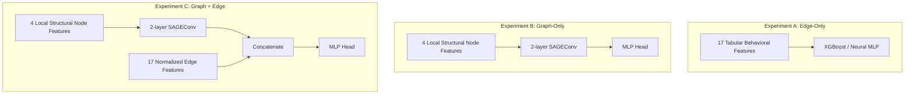
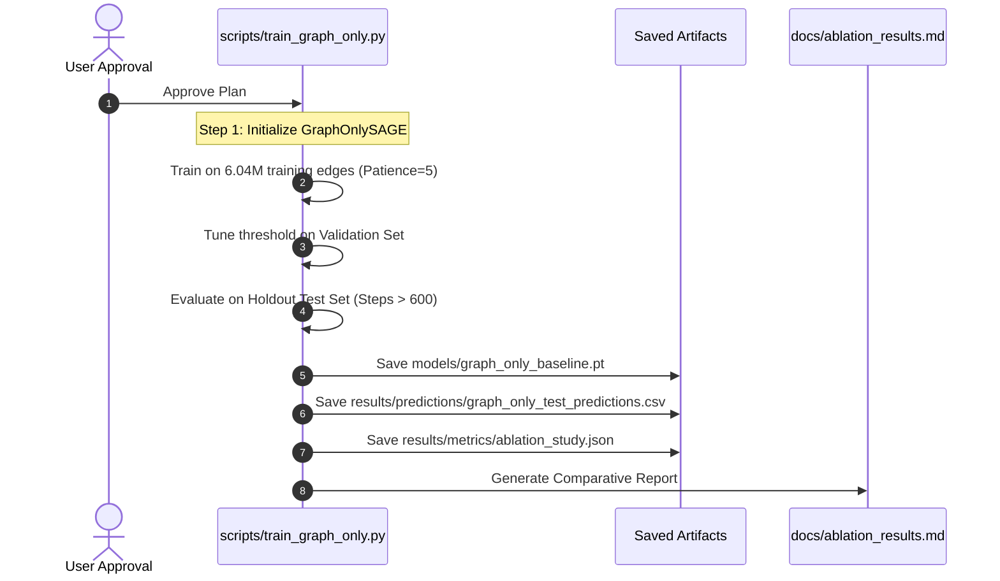

# Ablation Experiment Plan: Isolating Graph Structure Value

**Project:** Fraud Detection using Graph Neural Networks + Temporal ML  
**Directory:** `/Users/kaviprakashranjan/Downloads/FRAUD DETECTION`  
**Date:** October 11, 2026  
**Objective:** Establish a methodologically rigorous, fair, and computationally efficient ablation experiment comparing **Edge-Only**, **Graph-Only**, and **Graph + Edge** representations to quantify the genuine marginal contribution of graph structure in temporal fraud detection.

---

## 1. Existing Components That Can Be Reused

To minimize redundant computation and preserve historical integrity, the ablation leverages validated, pre-existing assets:

| Component | Asset Location | Reusability Status | Rationale |
| :--- | :--- | :--- | :--- |
| **Chronological Dataset Splits** | `data/processed/train.csv`<br>`data/processed/val.csv`<br>`data/processed/test.csv` | **100% Reused** | Preserves identical test benchmarks across all experiments. |
| **Edge Feature Normalizer** | `models/graphsage_edge_scaler.pkl` | **100% Reused** | `NeuralEdgeScaler` fit strictly on training mask (`train_mask`). |
| **Transaction Graph & Masks** | `data/processed/graph/paysim_graph.pt` | **100% Reused** | Complete 9.07M node, 6.36M edge graph with causal splits. |
| **Temporal Neighbor Sampler** | `src/data/temporal_sampler.py` | **100% Reused** | Validated NumPy CSR sampler enforcing strict `edge_time < target_time`. |
| **Structural Feature Generator** | `src/features/structural_features.py` | **100% Reused** | Local subgraph log-degree & unique neighbor feature extractor. |
| **XGBoost Model B (Edge-Only Baseline)** | `models/xgboost_model_b.pkl`<br>`results/predictions/xgboost_model_b_test_predictions.csv` | **100% Reused** | Already trained, threshold-tuned (0.90), evaluated (F1=0.5540, PR-AUC=0.5605). No retraining required. |
| **GraphSAGE Baseline (Graph + Edge)** | `models/graphsage_baseline.pt`<br>`results/predictions/graphsage_test_predictions.csv` | **100% Reused** | Already trained (Epoch 16), threshold-tuned (0.90), evaluated (F1=0.5415, PR-AUC=0.5468). No retraining required. |

**Net Result:** Only **one experiment (Graph-Only)** needs to be executed to complete the 3-way ablation!

---

## 2. Exact Feature Definitions for Each Experiment



### Experiment A: Edge-Only
* **Feature Count:** 17 features.
* **Features Used:**
  1. `amount`
  2. `type_is_PAYMENT`
  3. `type_is_TRANSFER`
  4. `type_is_CASH_OUT`
  5. `type_is_DEBIT`
  6. `type_is_CASH_IN`
  7. `sender_hist_tx_count`
  8. `sender_hist_amt_sum`
  9. `sender_hist_amt_avg`
  10. `sender_hist_amt_max`
  11. `sender_amt_dev_from_avg`
  12. `sender_time_since_last_tx`
  13. `receiver_hist_tx_count`
  14. `receiver_hist_amt_sum`
  15. `receiver_hist_amt_avg`
  16. `receiver_hist_amt_max`
  17. `receiver_time_since_last_tx`
* **Features Excluded:** All 8 synthetic balance proxy features (`*balance*`) and all graph message-passing embeddings.

### Experiment B: Graph-Only
* **Feature Count:** 4 structural node features; 0 edge features.
* **Features Used:**
  1. `log1p(historical_received_transaction_count)` ($in\_degree$)
  2. `log1p(historical_sent_transaction_count)` ($out\_degree$)
  3. `log1p(historical_total_transaction_count)` ($total\_degree$)
  4. `log1p(historical_unique_neighbors)`
* **Graph Structure:** Local historical subgraphs extracted by `TemporalSampler` (up to 2 hops, $k=[10, 10]$) strictly with `edge_time < target_time`.
* **Features Excluded:** All 17 transaction edge features (`amount`, `type`, rolling sender/receiver velocities are stripped).

### Experiment C: Graph + Edge (Full Model)
* **Feature Count:** 4 structural node features + 17 normalized transaction edge features.
* **Features Used:** Both the 4 local structural node features (passed through 2 SAGEConv layers to produce 64-dim $h_{src}$ and $h_{dst}$) AND the 17 standardized transaction edge features concatenated into the MLP classifier head ($64 + 64 + 17 = 145$ input dimensions).

---

## 3. Proposed Model Configurations

| Parameter | Experiment A (Edge-Only: XGBoost Model B) | Experiment A-Neural (Edge-Only MLP Control) | Experiment B (Graph-Only SAGE) | Experiment C (Graph + Edge SAGE) |
| :--- | :--- | :--- | :--- | :--- |
| **Model Family** | Gradient Boosted Trees | Neural Multi-Layer Perceptron | Graph Neural Network (SAGEConv) | Graph Neural Network (SAGEConv) |
| **Message Passing** | None | None | 2 SAGEConv layers (4 -> 64 -> 64) | 2 SAGEConv layers (4 -> 64 -> 64) |
| **Node Representation** | N/A | N/A | $h_{src} \in \mathbb{R}^{64}, h_{dst} \in \mathbb{R}^{64}$ | $h_{src} \in \mathbb{R}^{64}, h_{dst} \in \mathbb{R}^{64}$ |
| **Classifier Head** | 150 Trees, Max Depth 6 | Linear(17, 64) -> ReLU -> Dropout -> Linear(64, 32) -> ReLU -> Linear(32, 1) | Linear(128, 64) -> ReLU -> Dropout -> Linear(64, 32) -> ReLU -> Linear(32, 1) | Linear(145, 64) -> ReLU -> Dropout -> Linear(64, 32) -> ReLU -> Linear(32, 1) |
| **Input Dimension** | 17 | 17 | 128 ($64 + 64$) | 145 ($64 + 64 + 17$) |
| **Trainable Params** | N/A (Trees) | 3,809 | 19,201 | 20,289 |
| **Loss Function** | Binary Logistic (`scale_pos_weight=1128.08`) | `BCEWithLogitsLoss` (`pos_weight=1128.08`) | `BCEWithLogitsLoss` (`pos_weight=1128.08`) | `BCEWithLogitsLoss` (`pos_weight=1128.08`) |
| **Optimizer** | Exact Greedy / Hist | Adam (lr=1e-3) | Adam (lr=1e-3) | Adam (lr=1e-3) |
| **Batch Size** | Full Train Split Matrix | 2048 | 2048 | 2048 |
| **Execution Status** | **Completed & Serialized** | Optional Control (~2 min train) | **New Target Run** | **Completed & Serialized** |

---

## 4. Temporal Leakage Safeguards

All three experimental settings strictly adhere to the project's leakage-prevention protocol:

1. **Chronological Horizon:**
   - Training: `step <= 480` (steps 1–480).
   - Validation: `480 < step <= 600` (steps 481–600).
   - Testing: `step > 600` (steps 601–743).
2. **Causal Edge Sampling:**
   - In Experiments B and C, for target edge $(u, v)$ at time $t$, message passing occurs strictly over $\{e \in E \mid \text{edge\_time}(e) \le t - 1\}$.
   - Target edge $e_{target}$ is explicitly excised from the message-passing graph (`e_ids != t_id`).
3. **Disjoint Subgraph Construction:**
   - Targets within the same batch are mapped into isolated subgraphs. No temporal information can leak from Target A ($t=100$) to Target B ($t=50$) within the same tensor.
4. **Validation-Only Tuning:**
   - Classification thresholds are tuned strictly on the validation set (`val_mask`).
   - The test set is evaluated strictly once using the frozen validation threshold.

---

## 5. Fairness Limitations & Confounders

When presenting these ablation findings in technical interviews or documentation, the following methodological nuances must be explicitly acknowledged:

1. **Model Class Divergence (Tree vs. Neural):**
   - XGBoost Model B uses decision trees, which natively handle unscaled tabular data, step-functions, and feature interactions with extreme efficiency.
   - GraphSAGE uses continuous gradient descent with ReLU activations and linear projections.
   - *Mitigation:* We define XGBoost Model B as the primary tabular industry baseline, while providing an optional Edge-Only MLP as an architectural control.
2. **Structural Depth Constrained by Compute:**
   - Due to CPU execution on macOS ARM64 without `pyg-lib`, GraphSAGE is limited to 2-hop neighborhoods with $k=[10, 10]$ sampling. Deeper patterns (e.g. 3-hop money-laundering rings) are truncated.
3. **Information Asymmetry in Graph-Only:**
   - The Graph-Only model lacks transaction `amount` and transaction `type`. Fraud in PaySim is heavily concentrated in `TRANSFER` and `CASH_OUT` with large amounts. If Graph-Only performs modestly, it illustrates how vital transaction context is, rather than disproving the utility of graph topology.

---

## 6. Expected Training Time & Computational Budget

| Experiment | Required Action | Hardware | Est. Batches/Epoch | Est. Time/Epoch | Est. Total Runtime |
| :--- | :--- | :--- | :--- | :--- | :--- |
| **Exp A: XGBoost Model B** | Reused from disk (`models/xgboost_model_b.pkl`) | N/A | N/A | N/A | **0 seconds** |
| **Exp A-Neural: Edge MLP** *(Optional)* | Train 3-layer MLP on 6.04M rows | CPU | 2,950 | ~10 seconds | **~1.5 minutes** (10 epochs) |
| **Exp B: Graph-Only SAGE** | Train SAGEConv on 6.04M targets with $k=[10, 10]$ | CPU | 2,950 | ~320 seconds | **~35–50 minutes** (Patience 5, ~7–9 epochs) |
| **Exp C: Graph + Edge SAGE** | Reused from disk (`models/graphsage_baseline.pt`) | N/A | N/A | N/A | **0 seconds** |

**Total Estimated Compute Cost:** Under 1 hour on CPU.

---

## 7. Proposed Result Metrics & Output Schema

The ablation results will be saved to `results/metrics/ablation_study.json` and summarized in `docs/ablation_results.md`:

| Metric | Edge-Only (XGBoost B) | Edge-Only (Neural MLP) | Graph-Only (SAGE) | Graph + Edge (Full SAGE) | Primary Comparison Focus |
| :--- | :--- | :--- | :--- | :--- | :--- |
| **Precision** | `0.4585` | *TBD* | *TBD* | `0.4413` | False alarm burden |
| **Recall** | `0.7000` | *TBD* | *TBD* | `0.7006` | Fraud detection rate |
| **F1 Score** | `0.5540` | *TBD* | *TBD* | `0.5415` | Harmonic balance |
| **PR-AUC** | `0.5605` | *TBD* | *TBD* | `0.5468` | Ranking under severe imbalance |
| **ROC-AUC** | `0.9547` | *TBD* | *TBD* | `0.9501` | Overall discriminative power |
| **Threshold** | `0.90` | *TBD* | *TBD* | `0.90` | Selected on validation |

Additionally, test prediction files will be archived:
- `results/predictions/xgboost_model_b_test_predictions.csv` (Existing)
- `results/predictions/graph_only_test_predictions.csv` (To be generated)
- `results/predictions/graphsage_test_predictions.csv` (Existing)

---

## 8. Minimum Implementation Changes Required

To implement Experiment B without disrupting existing code:

1. **Add Model Class in `src/models/graphsage.py`:**
   Add `GraphOnlySAGE` (or add an `edge_feature_dim=0` branch in `TemporalGraphSAGE`).
   ```python
   class GraphOnlySAGE(nn.Module):
       def __init__(self, node_feature_dim=4, hidden_dim=64, dropout=0.2):
           super().__init__()
           self.conv1 = SAGEConv(node_feature_dim, hidden_dim)
           self.conv2 = SAGEConv(hidden_dim, hidden_dim)
           self.dropout = dropout
           self.mlp = nn.Sequential(
               nn.Linear(hidden_dim * 2, hidden_dim),
               nn.ReLU(),
               nn.Dropout(dropout),
               nn.Linear(hidden_dim, hidden_dim // 2),
               nn.ReLU(),
               nn.Dropout(dropout),
               nn.Linear(hidden_dim // 2, 1)
           )
   ```
2. **Create Dedicated Runner `scripts/train_graph_only.py`:**
   - Reuses `paysim_graph.pt`, `TemporalSampler`, and `create_collate_fn`.
   - Passes `target_edge_features = None` into the model.
   - Saves checkpoint to `models/graph_only_baseline.pt`.
   - Saves predictions to `results/predictions/graph_only_test_predictions.csv`.
   - Updates `results/metrics/ablation_study.json`.

---

## 9. Recommended Execution Order



1. **Review & Approval:** User approves the ablation plan.
2. **Implement `GraphOnlySAGE` & Script:** Implement `scripts/train_graph_only.py` without modifying existing models.
3. **Launch Graph-Only Training:** Run on CPU in the background (~40 minutes).
4. **Aggregate Results:** Merge metrics into `results/metrics/ablation_study.json` comparing Edge-Only vs. Graph-Only vs. Graph+Edge.
5. **Publish Comparative Analysis:** Generate `docs/ablation_results.md` and update `README.md`.
