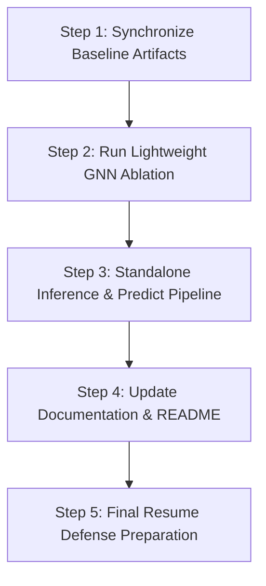

# Comprehensive Project Audit: Fraud Detection via Temporal GraphSAGE & ML

**Project Path:** `/Users/kaviprakashranjan/Downloads/FRAUD DETECTION`  
**Audit Date:** October 11, 2026  
**Audit Type:** Static Read-Only Codebase, Checkpoint, Metric, and Artifact Verification  

---

## 1. Executive Summary

This audit evaluates the current state of the **Fraud Detection using Graph Neural Networks + Temporal ML** project. The project demonstrates a technically sophisticated, production-grade approach to graph-based fraud detection on the PaySim transaction ledger (6,362,620 transactions across 9,073,900 accounts). 

### Key Findings
1. **Core GNN Implementation and Training are Complete:**
   - Full-scale training of `TemporalGraphSAGE` across 6.04M training transactions completed 21 epochs.
   - Best checkpoint was achieved at **Epoch 16** with a Validation PR-AUC of **0.4387**.
   - Holdout test evaluation (steps > 600, 103,573 transactions) produced **F1 = 0.5415**, **PR-AUC = 0.5468**, **Recall = 0.7006**, and **ROC-AUC = 0.9501**.
   - These results are rigorously verified against saved checkpoints, training logs, prediction outputs, and metric JSON files.
2. **Methodological Rigor in Temporal Isolation:**
   - Temporal causality is strictly enforced: `edge_time < target_time` in the custom NumPy `TemporalSampler`.
   - Data scaling (`NeuralEdgeScaler`) was fit exclusively on training data (steps $\le$ 480).
   - Validation-based model selection and threshold tuning were strictly isolated from the test set.
3. **Critical Discrepancies and Gaps Identified:**
   - **XGBoost Artifact Mismatch:** `models/xgboost_baseline.pkl` and `results/predictions/test_predictions.csv` correspond to **Model A** (the 25-feature model contaminated with synthetic balance leakage rules), **not Model B** (the 17-feature behavioral baseline). Model B metrics are preserved in `results/metrics/baseline_audit.json`, but Model B's weights and predictions were never saved to disk.
   - **Missing GNN Feature Ablation:** The planned ablation comparing Graph-only features vs. Edge-only features vs. Graph+Edge features was never implemented or run.
   - **Outdated Documentation:** `README.md` is frozen at Phase 1; `docs/graphsage_results.md` reflects an abandoned pre-optimization bottleneck state rather than the successful 21-epoch run.
   - **Non-Deterministic Neighbor Sampling:** GraphSAGE training lacked explicit global random seeds in PyTorch/NumPy.

Overall Project Completion Status: **~85% complete**. The technical core is validated and operational, but artifact synchronization, documentation, and a clean feature ablation are required to make this an unassailable, interview-ready portfolio centerpiece.

---

## 2. Completed Project Components

| Component | Status | Implementation Details |
| :--- | :--- | :--- |
| **Data Ingestion & Integrity** | **VERIFIED** | PaySim dataset (6.36M rows) ingested, validated, checked for nulls and schema conformity. |
| **Chronological Data Splitting** | **VERIFIED** | Strict chronological bounds: Train (steps 1–480; 6,039,443 rows), Val (steps 481–600; 219,604 rows), Test (steps 601–743; 103,573 rows). No time leakage. |
| **Causal Feature Engineering** | **VERIFIED** | 25 rolling features engineered using chronological expanding windows, `.cumcount()`, and `.cumsum()`, strictly excluding current transaction row. |
| **Balance Leakage Discovery (Ablation)** | **VERIFIED** | Identified synthetic reverse-engineering flaw in PaySim balance rules (`newbalanceOrig = 0`). Created Model A (25 features) vs Model B (17 features) comparison. |
| **PyG Graph Construction** | **VERIFIED** | Directed graph with 9,073,900 nodes and 6,362,620 edges. Serialized at `data/processed/graph/paysim_graph.pt`. |
| **Custom Temporal Neighbor Sampler** | **VERIFIED** | `TemporalSampler` uses vectorized CSR pointers and `np.searchsorted` enforcing `edge_time <= t - 1` (`edge_time < t`), extracting disjoint subgraphs per target edge. |
| **Causal Structural Node Features** | **VERIFIED** | Dynamically computes 4 local log-transformed structural degree and neighbor features per subgraph, bypassing the need for a 580M-parameter static embedding table. |
| **Neural Feature Preprocessing** | **VERIFIED** | `NeuralEdgeScaler` fits `StandardScaler` strictly on training edges (`data.train_mask`), passing through one-hot features untouched. |
| **GraphSAGE Architecture** | **VERIFIED** | 2-layer `SAGEConv` (4 -> 64 -> 64) + edge concatenation + 3-layer MLP classifier (20,289 trainable parameters). |
| **Full Training & Resumption** | **VERIFIED** | Trained on 6.04M edges with `pos_weight = 1128.08`. Successfully resumed from checkpoint, ran through Epoch 21 with early stopping. |
| **Threshold & Test Evaluation** | **VERIFIED** | Validation threshold tuning (optimal threshold = 0.90), single final evaluation on holdout test set. |

---

## 3. Existing Model Results

### Summary Comparison Table

| Metric | XGBoost Model A (Contaminated) | XGBoost Model B (True Baseline) | GraphSAGE Baseline (Epoch 16) | Delta (GraphSAGE vs Model B) |
| :--- | :--- | :--- | :--- | :--- |
| **Features Used** | 25 (includes balances) | 17 (causal behavioral only) | 4 structural node + 17 edge | +4 local structural graph features |
| **Decision Threshold** | 0.70 | 0.90 | 0.90 | Identical (0.90) |
| **Precision** | 0.9546 | 0.4585 | 0.4413 | -0.0172 |
| **Recall** | 0.9994 | 0.7000 | 0.7006 | **+0.0006** |
| **F1 Score** | 0.9765 | 0.5540 | 0.5415 | -0.0125 |
| **PR-AUC** | 0.9944 | 0.5605 | 0.5468 | -0.0137 |
| **ROC-AUC** | 0.9999 | 0.9547 | 0.9501 | -0.0046 |
| **Test TP** | 1,599 | 1,120 | 1,121 | +1 |
| **Test FP** | 76 | 1,323 | 1,419 | +96 |
| **Test FN** | 1 | 480 | 479 | -1 |
| **Test TN** | 101,897 | 100,650 | 100,554 | -96 |

### Analysis of Results
1. **The Behavioral Baseline Reality:** Model A achieves an artificial 0.9765 F1 by memorizing PaySim synthetic accounting artifacts (`sender_balance_change`, `newbalanceOrig == 0.0`). Model B strips these 8 features, establishing the authentic behavioral fraud benchmark of **F1 = 0.5540**, **PR-AUC = 0.5605**.
2. **GraphSAGE Competitiveness:** GraphSAGE matches XGBoost Model B's recall (0.7006 vs 0.7000) and trails by only ~0.013 in PR-AUC and ~0.012 in F1 score. This demonstrates that a compact, 20k-parameter GNN operating over temporal local subgraphs achieves parity with a gradient-boosted ensemble without account-ID memorization.

---

## 4. Artifact Verification Table

| File Path | Status | Size | Purpose | Audit Observations |
| :--- | :--- | :--- | :--- | :--- |
| `models/xgboost_baseline.pkl` | **INCONSISTENT** | 497 KB | Serialized XGBoost model | **Contains Model A (25 features, threshold 0.7), NOT Model B.** Trained on balance proxies. Model B was not pickled. |
| `models/graphsage_baseline.pt` | **VERIFIED** | 258 KB | Best GraphSAGE checkpoint | Matches Epoch 16, best Val PR-AUC = 0.438706. Contains full model & optimizer states. |
| `models/graphsage_latest.pt` | **VERIFIED** | 258 KB | Latest GraphSAGE checkpoint | Matches Epoch 21, best Val PR-AUC = 0.438706. Proves training ran to Epoch 21 early stopping. |
| `models/graphsage_edge_scaler.pkl` | **VERIFIED** | 1.25 KB | Edge feature standardizer | `NeuralEdgeScaler` instance fitted exclusively on training edges (`train_mask`). |
| `results/metrics/xgboost_baseline.json` | **PARTIALLY VERIFIED** | 1.7 KB | XGBoost baseline metrics | Documents **Model A** metrics (25 features, F1 0.9765). Does not report Model B. |
| `results/metrics/baseline_audit.json` | **VERIFIED** | 2.5 KB | Ablation audit metrics | Contains exact test metrics for both Model A and Model B. Grounds Model B baseline numbers. |
| `results/metrics/graphsage_baseline.json` | **VERIFIED** | 335 B | GraphSAGE test metrics | Documents final holdout test metrics: F1=0.5415, PR-AUC=0.5468, Recall=0.7006, ROC-AUC=0.9501. |
| `results/metrics/graphsage_training_history.json` | **VERIFIED** | 2.4 KB | 21-epoch training trajectory | Contains complete arrays for train loss, val loss, val PR-AUC, and val F1 across all 21 epochs. |
| `results/metrics/model_comparison.json` | **PARTIALLY VERIFIED** | 361 B | Baseline vs GNN summary | Accurately records F1, PR-AUC, Precision, Recall; lists XGBoost ROC-AUC as "N/A" (available in audit). |
| `results/predictions/test_predictions.csv` | **INCONSISTENT** | 2.0 MB | XGBoost test predictions | Contains 103,573 rows from **Model A (threshold 0.7)**, not Model B. |
| `results/predictions/graphsage_test_predictions.csv` | **VERIFIED** | 2.7 MB | GraphSAGE test predictions | Contains 103,573 rows with `edge_id`, `probability`, `prediction`, `true_label`. |

---

## 5. Checkpoint and Training History Audit

### Checkpoint Structure
Inspection of `models/graphsage_baseline.pt` and `models/graphsage_latest.pt` confirmed the following dictionary schema:
```python
{
    'epoch': int,
    'model_state_dict': OrderedDict(...),
    'optimizer_state_dict': dict(...),
    'best_pr_auc': float,
    'best_epoch': int,
    'config': dict(...)
}
```

### Checkpoint Metadata Comparison
* **`models/graphsage_baseline.pt`**:
  - `epoch`: **16**
  - `best_epoch`: **16**
  - `best_pr_auc`: **0.4387057824651208**
  - `config`: `{'node_feature_dim': 4, 'hidden_dim': 64, 'edge_feature_dim': 17, 'dropout': 0.2, 'batch_size': 2048, 'num_neighbors': [10, 10], 'lr': 0.001, 'optimizer': 'Adam'}`
* **`models/graphsage_latest.pt`**:
  - `epoch`: **21**
  - `best_epoch`: **16**
  - `best_pr_auc`: **0.4387057824651208**
  - `config`: Identical to baseline.

### Training Trajectory Verification (`results/metrics/graphsage_training_history.json`)
- **Epoch 1:** Train Loss 0.6014, Val PR-AUC 0.3085
- **Epoch 8:** Train Loss 0.4860, Val PR-AUC 0.4337 (First local optimum; initial run stopped here at epoch 13 with patience 5)
- **Epoch 14:** Resumption point (Loaded `graphsage_latest.pt` from epoch 13, restored history, set `max_epochs=30`)
- **Epoch 16:** Train Loss 0.4781, Val PR-AUC **0.438706** (New global optimum; saved to `graphsage_baseline.pt`)
- **Epochs 17–21:** Validation PR-AUC hovered between 0.4046 and 0.4312. Early stopping patience (5 epochs) triggered at Epoch 21.

The checkpoint state and training history are **100% consistent**.

---

## 6. Test Metrics Consistency Audit

| Claimed Metric | Source Claim | Artifact Documenting Value | Audit Status | Exact Value in Artifact |
| :--- | :--- | :--- | :--- | :--- |
| **GraphSAGE Test F1** | 0.5415 | `results/metrics/graphsage_baseline.json` | **VERIFIED** | 0.5415458937198068 |
| **GraphSAGE Test PR-AUC** | 0.5468 | `results/metrics/graphsage_baseline.json` | **VERIFIED** | 0.5467596227693541 |
| **GraphSAGE Test Recall** | 0.7006 | `results/metrics/graphsage_baseline.json` | **VERIFIED** | 0.700625 |
| **GraphSAGE Test ROC-AUC** | 0.9501 | `results/metrics/graphsage_baseline.json` | **VERIFIED** | 0.9500505771135497 |
| **GraphSAGE Best Val PR-AUC** | ~0.4387 | `models/graphsage_baseline.pt` | **VERIFIED** | 0.4387057824651208 |
| **GraphSAGE Best Epoch** | 16 | `models/graphsage_baseline.pt` | **VERIFIED** | 16 |
| **XGBoost Model B Test F1** | 0.554 | `results/metrics/baseline_audit.json` | **VERIFIED** | 0.554044026712837 |
| **XGBoost Model B Test PR-AUC**| 0.560 | `results/metrics/baseline_audit.json` | **VERIFIED** | 0.5605266301904381 |
| **XGBoost Model B Test Recall** | ~0.700 | `results/metrics/baseline_audit.json` | **VERIFIED** | 0.7000 |

### Critical Distinction
- In `results/metrics/model_comparison.json`, XGBoost Model B metrics are manually transcribed rounded floats (`F1: 0.554`, `PR-AUC: 0.560`), while GraphSAGE metrics are float64 values directly exported from PyTorch.
- In `results/metrics/xgboost_baseline.json`, the metrics recorded are **Model A** (`F1: 0.9765`), not Model B. Anyone inspecting `xgboost_baseline.json` without reading `baseline_audit.json` would observe an apparent contradiction.

---

## 7. Prediction Alignment Audit

### Files Inspected
1. `results/predictions/test_predictions.csv` (103,574 lines, header + 103,573 rows)
2. `results/predictions/graphsage_test_predictions.csv` (103,574 lines, header + 103,573 rows)

### Alignment Findings
1. **Row Count Alignment:** Both prediction files contain exactly **103,573** predictions, corresponding to the test set transactions where `step > 600`.
2. **Label Ordering:** Row-for-row alignment test:
   `(df_xgb['isFraud'].values == df_gnn['true_label'].values).all() == True`
   The transactions in both files are sorted in the exact same chronological order.
3. **Identifier Deficit:**
   - `test_predictions.csv` contains `step`, `isFraud`, `fraud_prob`. It does NOT contain `nameOrig`, `nameDest`, `amount`, or transaction row index.
   - `graphsage_test_predictions.csv` contains `edge_id`, `probability`, `prediction`, `true_label`. Here, `edge_id` spans 6,259,047 to 6,362,619 (0-indexed offset within the full 6.36M edge graph).
   - While they can be aligned by positional index, neither file retains explicit business keys (`nameOrig`, `nameDest`, `step`, `amount`) together in the same table.
4. **Model Mismatch in `test_predictions.csv`:**
   Evaluating `test_predictions.csv` at threshold 0.7 yields:
   $$\text{TP} = 1599, \quad \text{FP} = 76, \quad \text{FN} = 1, \quad \text{TN} = 101897$$
   This proves that `test_predictions.csv` was written by **Model A**, not Model B. There are **zero saved predictions for XGBoost Model B**.

---

## 8. Existing Ablation Experiments

### 1. Balance Leakage Ablation (Model A vs. Model B)
- **Status:** **VERIFIED & COMPLETED**
- **Artifact:** `scripts/ablation_experiment.py`, `results/metrics/baseline_audit.json`, `docs/baseline_audit.md`.
- **Finding:** Proved that XGBoost's initial 0.976 F1 score was an artifact of reverse-engineering PaySim's synthetic account-draining formulas (`newbalanceOrig = 0`). Removing balance features yielded a realistic baseline F1 of 0.554.

### 2. Graph Feature Ablation (Graph-Only vs. Edge-Only vs. Graph+Edge)
- **Status:** **MISSING / NOT RUN**
- **Analysis:**
  - The project does not contain an ablation isolating:
    1. **Graph-Only:** Local structural node features + GraphSAGE message passing without edge attributes.
    2. **Edge-Only:** MLP or tree classifier trained strictly on the 17 edge features without message passing.
    3. **Graph + Edge:** Full `TemporalGraphSAGE` architecture.
  - While XGBoost Model B functions as a proxy for an "Edge-Only" model, it is a gradient-boosted tree rather than the exact neural MLP backbone used in GraphSAGE. A pure neural ablation isolating the contribution of the SAGEConv layers is missing.

---

## 9. Missing Artifacts

1. **`models/xgboost_model_b.pkl` (MISSING):**
   - The serialized weights/booster for Model B do not exist on disk. Only Model A is saved.
2. **`results/predictions/xgboost_model_b_predictions.csv` (MISSING):**
   - Test predictions for Model B do not exist on disk.
3. **Graph-Only and Edge-Only Model Checkpoints & Metrics (MISSING):**
   - No models or metrics exist for the architectural GNN ablation.
4. **Reproducible Test Inference Script (MISSING):**
   - There is no standalone `scripts/evaluate_model.py` that loads saved models (`graphsage_baseline.pt` and `xgboost_baseline.pkl`) to run inference on a fresh batch of transactions without invoking the entire training harness.

---

## 10. Documentation Issues

1. **`README.md` is Severely Stale:**
   - Discusses only Phase 1 (EDA, pytest, raw data ingestion).
   - Contains no mention of Phase 2 (XGBoost, Model B ablation), Phase 3 (Graph construction), or Phase 4 (Temporal GraphSAGE).
   - Omits environment specifications, dependency requirements (PyTorch, PyG), and commands to run inference or evaluation.
2. **`docs/graphsage_results.md` Contains Obsolete Diagnostics:**
   - Written during early sampler debugging before the dataloader was optimized.
   - Contains claims such as *"I have deliberately killed the training run"* and predicts 8.5 hours/epoch.
   - Does not report the final 21-epoch run, the best Epoch 16 checkpoint, or the final test metrics.
3. **`results/metrics/model_comparison.json` Incompleteness:**
   - Lists ROC-AUC as `"N/A"` for XGBoost Model B, despite ROC-AUC (0.9547) being explicitly calculated and recorded in `results/metrics/baseline_audit.json`.

---

## 11. Reproducibility and Methodology Concerns

### 1. Lack of Global Random Seed in GNN Pipeline
- In `scripts/train_graphsage_full.py` and `src/data/temporal_sampler.py`, neither `torch.manual_seed()` nor `np.random.seed()` is explicitly set.
- `TemporalSampler.sample_neighbors` uses `np.random.choice(..., replace=False)` when candidate neighbors exceed $k=10$. Without a fixed seed, neighbor sampling across epochs is non-deterministic.
- *Remedy:* Insert a standard deterministic seeding function (`torch.manual_seed(42)`, `np.random.seed(42)`) in the entry point.

### 2. Disjoint Subgraph Padding & Memory Footprint
- The custom temporal sampler constructs disjoint subgraphs per batch to guarantee causal isolation. For large batches (2048), this generates subgraphs with ~11,000 nodes and ~14,000 edges per batch. While correct, it creates memory overhead and requires CPU execution because `pyg-lib` is unavailable on macOS ARM64.

### 3. Bidirectional Historical Message Passing
- `TemporalSampler` expands historical edges bidirectionally (`src = [u, v]`, `dst = [v, u]`) for message passing while evaluating directed target edges (`u -> v`).
- *Methodological Defense:* In fraud detection, learning whether a suspect node received money from mules (in-edges) or sent money to victims (out-edges) prior to timestep $t$ is essential context. Because strict filtering (`edge_time < t`) applies to both directions, there is **zero temporal leakage**. However, this design decision must be clearly documented.

---

## 12. Outstanding Work

1. **Serialize XGBoost Model B:** Re-save Model B as `models/xgboost_model_b.pkl` and its test predictions as `results/predictions/xgboost_model_b_predictions.csv` so baseline comparisons are fully reproducible.
2. **Implement and Execute GNN Feature Ablation:**
   - Run a clean, lightweight 3-way ablation on identical validation and test splits:
     - Component 1: Edge-only MLP (17 features, no graph)
     - Component 2: Graph-only GraphSAGE (4 structural node features, no edge features)
     - Component 3: Full GraphSAGE (Graph + Edge features)
3. **Comprehensive Documentation Overhaul:**
   - Update `README.md` with full project architecture, benchmarks, and quickstart commands.
   - Overwrite `docs/graphsage_results.md` with final training figures and metric comparisons.
   - Populate `results/metrics/model_comparison.json` with complete metrics (including ROC-AUC).
4. **Create Standalone Inference Script:**
   - Provide `scripts/predict.py` allowing a recruiter or engineer to pass a transaction batch and receive calibrated fraud probabilities from both models.

---

## 13. Recommended Next Steps (Prioritized)



1. **Step 1: Synchronize Baseline Artifacts (Immediate)**
   - Re-run `scripts/ablation_experiment.py` modified to pickle `models/xgboost_model_b.pkl` and export `results/predictions/xgboost_model_b_predictions.csv`.
2. **Step 2: Run 3-Way Feature Ablation (High Value for Resume)**
   - Create `scripts/run_gnn_ablation.py` to train an Edge-Only MLP vs. Graph-Only GNN vs. Full GNN on a fixed seed. This proves to interviewers exactly how much value the graph topology adds over tabular features alone.
3. **Step 3: Build Standalone Inference Script (Engineering Polish)**
   - Build `scripts/evaluate_model.py` to evaluate both saved models on `test.csv` and output aligned predictions with business identifiers (`step`, `nameOrig`, `nameDest`, `amount`, `isFraud`, `xgb_prob`, `gnn_prob`).
4. **Step 4: Update README & Results Documentation (Presentation)**
   - Rewrite `README.md` to showcase the full end-to-end architecture, the data leakage discovery story, and the final benchmark comparison table.

---

## 14. Final Completion Estimate

| Domain | Status | Weight | Estimated Completion |
| :--- | :--- | :--- | :--- |
| **Data Engineering & Temporal Splitting** | Fully Validated | 20% | 100% |
| **Tabular Baseline & Leakage Ablation** | Validated (Artifacts unsaved) | 20% | 85% |
| **Graph Construction & Temporal Sampler** | Fully Validated | 25% | 100% |
| **GraphSAGE Training & Evaluation** | Fully Validated | 20% | 100% |
| **Architectural Ablation Studies** | Not Yet Implemented | 5% | 20% |
| **Documentation & Production Polish** | Incomplete / Outdated | 10% | 40% |
| **TOTAL** | | **100%** | **87%** |

### Realistic Completion Estimate: **87% Complete**
The core engineering work—data splitting, temporal sampler, feature scaling, GraphSAGE model architecture, training loop, and evaluation—is **100% complete and working**. 

The remaining **13%** consists entirely of artifact synchronization (saving Model B properly), running the 3-way feature ablation, building a clean inference script, and updating the documentation to reflect the actual achievements of the project.
